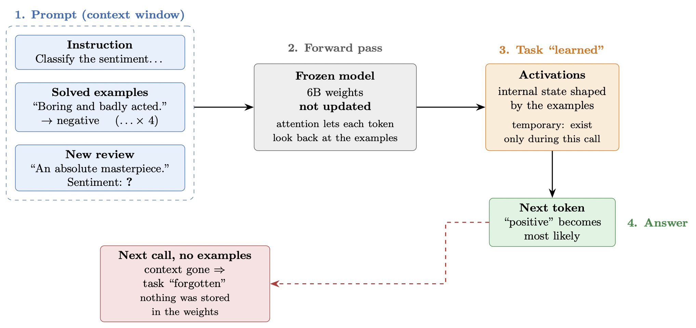

# In-context learning

- [Practical with in-context learning](https://github.com/neelsoumya/teaching_llm_applications/blob/main/practicals/llm_practical_6b_model.ipynb)

- Where does the learning happen in in-context learning? The weights of the model are fixed. What changes due to few-shot examples are the activations.

- The claim is that the model has learnt how to learn. It has acquired a skill. The ability to spot these patterns was already in the weights. One view is that transformers learn a _learning algorithm_

## Other thoughts

- The “learning” happens at inference time, in the model’s activations, and it disappears as soon as the prompt does.

- The weights were fixed during pretraining. When you put four solved examples in the prompt, the model reads them along with your review, and attention lets every later token look back at them. The examples change the internal activations, and so the probabilities of the next token. After “Sentiment:”, the continuation “positive” or “negative” becomes overwhelmingly likely, because that is the pattern the context sets up. 

- This is called _in-context learning_. 

- Nothing is stored. If you call the model again without the examples, it has “forgotten” the task.

- The ability to continue patterns, and to recognise sentiment, was already in the weights from pretraining. The examples mostly tell the model which task you want and what format the answer should take.

- One view is that this is task recognition rather than learning something new. Another is that transformers implement something like a small learning algorithm in their forward pass. Research is still divided.

