# Reasoning models and GRPO

- [🎥 Video from Stanford CME295](https://www.youtube.com/watch?v=k5Fh-UgTuCo)

- [video on GRPO and DeepSeek](https://www.youtube.com/watch?v=xT4jxQUl0X8&pp=ugUEEgJlbg%3D%3D)

# Reasoning Large Language Models (LLMs)

**Reasoning Large Language Models (LLMs) learn to think by extending standard text generation into multi-step problem-solving using specialized training methods and test-time computation.**

## How Reasoning Models Learn

### 1. Pre-training (Foundational Knowledge)

Models start with standard **next-token prediction** on massive datasets of text, code, and mathematics. This builds a foundational understanding of:

* Language
* Logic
* Mathematical patterns
* Programming and code
* General-world knowledge

### 2. Supervised Fine-Tuning (SFT) & Chain-of-Thought (CoT)

Models can be trained on data containing explicit **step-by-step rationales**, or *chain-of-thought (CoT)*, that map a complex problem to a correct final answer.

This encourages the model to break a problem down into **sequential reasoning steps** rather than attempting a single-shot answer.

* Problem → intermediate steps → final answer
* Complex problems are decomposed into smaller subproblems
* The model learns patterns associated with successful reasoning

### 3. Reinforcement Learning (RL) on Verifiable Rewards

Reasoning models can generate long reasoning trajectories and receive rewards based on the correctness of their outputs.

For tasks such as mathematics, programming, and formal reasoning, the answer can often be checked automatically.

#### Pure RL: DeepSeek-R1-Zero

**DeepSeek-R1-Zero** demonstrated that reasoning behaviours can emerge when reinforcement learning is applied directly to a base model using primarily rule-based rewards.

The model does not initially require a large collection of human-written reasoning traces.

Reported emergent behaviours include:

* Self-correction
* Verification
* Backtracking
* Exploring alternative solution paths
* Spending more computation on difficult problems

#### Group Relative Policy Optimization (GRPO)

**GRPO** evaluates multiple generated reasoning paths for the same problem and compares their rewards relative to one another.

A simplified picture is:

```text
                 Problem
                    │
          ┌─────────┼─────────┐
          ▼         ▼         ▼
       Path A     Path B     Path C
          │         │         │
        Score     Score      Score
          └─────────┼─────────┘
                    ▼
           Relative comparison
                    │
                    ▼
             Policy update
```

Rather than requiring an independent value model for every trajectory, GRPO can use the relative performance of a group of sampled solutions to guide learning.

### 4. Process and Outcome Supervision

Reasoning can be supervised at different levels.

#### Outcome Reward Models (ORMs)

An **Outcome Reward Model** evaluates the final answer.

```text
Problem → Reasoning → Final Answer → Reward
                                      ↑
                                  Correct?
```

The main question is:

> Did the model arrive at the correct answer?

#### Process Reward Models (PRMs)

A **Process Reward Model** evaluates individual reasoning steps.

```text
Problem
   │
   ▼
Step 1 → ✓
   │
   ▼
Step 2 → ✓
   │
   ▼
Step 3 → ✗
   │
   ▼
Final Answer
```

This allows training to distinguish between a reasoning process that is correct throughout and one that happens to arrive at a correct answer despite flawed intermediate reasoning.

### 5. Knowledge Distillation

Large reasoning models can generate large datasets containing reasoning trajectories.

These datasets can then be used to train **smaller student models**.

```text
        Large reasoning model
                 │
                 ▼
       Millions of reasoning
             examples
                 │
                 ▼
          Student model
                 │
                 ▼
       Smaller + cheaper model
```

The goal is to transfer some of the reasoning capabilities of a large, computationally expensive model into a smaller and more efficient model.

---

# How Reasoning Models Differ During Inference

The major difference is that reasoning models can use additional computation **at inference time**, rather than doing all of their computation during training.

This is often called **test-time compute** or **test-time scaling**.

## 1. Internal Scratchpads / Thinking Tokens

Instead of immediately producing an answer, a reasoning model can generate a long internal reasoning trajectory.

It can use this additional computation to:

* Explore alternative solutions
* Detect contradictions
* Verify mathematical calculations
* Check generated code
* Backtrack from incorrect approaches
* Refine an initial solution
* Compare different possibilities

Conceptually:

```text
Standard LLM

Prompt ───────────────► Answer


Reasoning LLM

Prompt
  │
  ▼
Think
  │
  ├──► Try approach A
  │
  ├──► Detect problem
  │
  ├──► Try approach B
  │
  ├──► Verify
  │
  └──► Correct answer
```

The internal reasoning tokens are sometimes described as a **scratchpad**.

> **Important:** The internal reasoning process of modern reasoning models should not necessarily be equated with the model's complete or literal "thought process." What is exposed to a user may be a summary or selected representation rather than the model's underlying computation.

## 2. Test-Time Scaling

A reasoning model can often be given a larger **thinking budget** at runtime.

For example:

```text
Low effort
   ↓
Small compute budget
   ↓
Fast response


Medium effort
   ↓
More computation
   ↓
More extensive reasoning


High effort
   ↓
Large compute budget
   ↓
More extensive search / verification
```

This is particularly useful for problems involving:

* Mathematics
* Programming
* Formal proofs
* Complex planning
* Logic puzzles
* Scientific reasoning

The central idea is:

> **Instead of making the model substantially larger, give it more computation when solving a difficult problem.**

---

# The Overall Picture

Reasoning LLMs can therefore be viewed as combining several components:

```text
                  PRE-TRAINING
                      │
                      ▼
             Foundational model
                      │
                      ▼
            Reasoning-oriented
              fine-tuning
                      │
          ┌───────────┴───────────┐
          ▼                       ▼
        SFT                      RL
     CoT examples        Verifiable rewards
          │                       │
          └───────────┬───────────┘
                      ▼
             Reasoning model
                      │
                      ▼
             TEST-TIME COMPUTE
                      │
          ┌───────────┼───────────┐
          ▼           ▼           ▼
       Search      Verify     Backtrack
          │           │           │
          └───────────┼───────────┘
                      ▼
                  Answer
```

The key conceptual shift is from:

> **"Predict the next token."**

towards:

> **"Use computation to search for a good solution before producing the answer."**

This does not mean that the underlying architecture necessarily changes dramatically. Much of the capability can arise from **training the model to use its existing generative machinery as a reasoning process and allocating additional computation at inference time**.

---

## Notes

- [🎥 Video from Stanford CME295](https://www.youtube.com/watch?v=k5Fh-UgTuCo)

- in-context learning examples

- _Concept_ 🧩 🚀

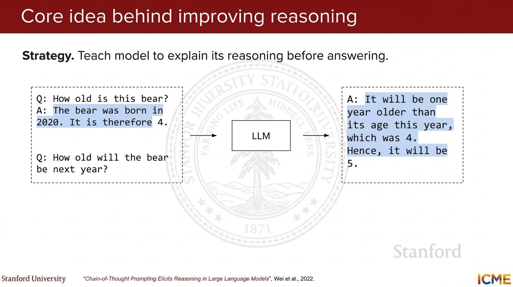

- output = reasoning + answer

- more tokens, so LLMs use more tokens and more compute

- _compute budget_

- complete chain of thought not shown (too long, can train another model that can mimic this model)

## Reasoning based benchmarks

- HumanEval, SWE-bench

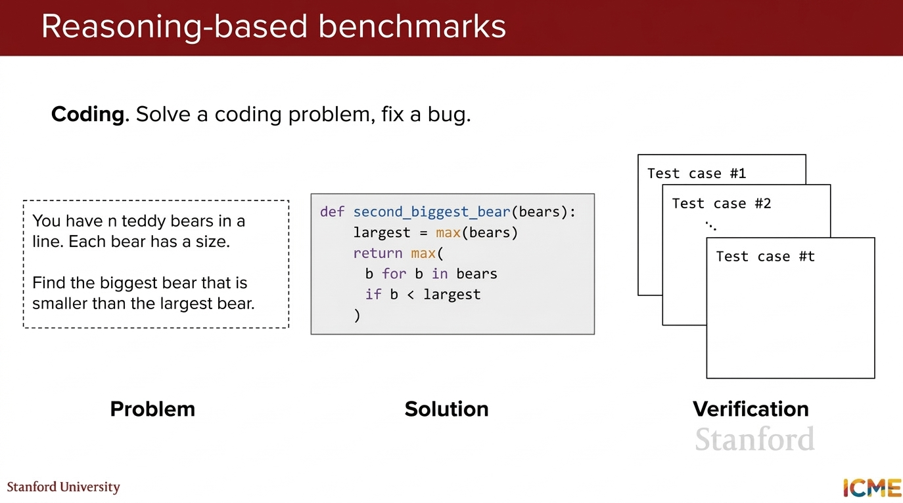

- Math: problem (prompt) -> solution (words + LaTeX)

- [AIME dataset](https://huggingface.co/datasets/MathArena/aime_2026): math Olympiad problems

- GSM8K: grade school math problems

- _what is the metric?_ pass@k Probability that at least one of _k_ generated attempts succeeds

- can afford to generate more than one answer

- _best of n_

- take _n_ attempts and _c_ successes

- pass@k vs. _T_ (temperature)

- formula for pass@k in terms of _c_ and _n_

- cons@k (majority voting)

## GRPO

- [🎥 video from Stanford CME295 course](https://youtu.be/k5Fh-UgTuCo?si=2J2Litju8JxVIl9k&t=2948)

- reasoning chain is hard to write from scratch

- _human written reasoning maybe different to how model reasons_

- try Reinforcement Learning

- _Concept_ 🧩 🚀 incentivize model to reason before answering

- GRPO: [G]roup [R]elative [P]olicy [O]ptimization

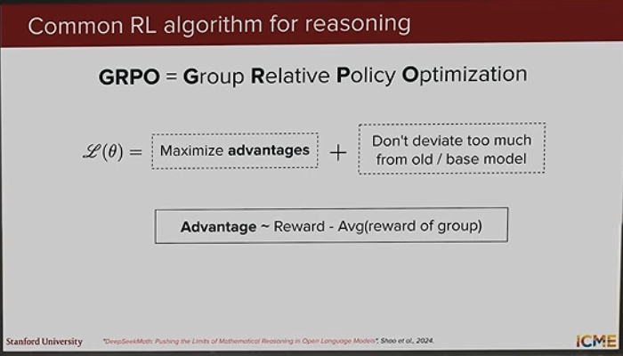

- _advantage_ = compare to completions (average)

- Reinforcement learning developed before LLMs

- sample multiple times and see how good this is

- _GRPO_ explained

- policy model is the LLM

- KL divergence so model does not deviate too much from base model

>How GRPO Works: A prompt is given. The student LLM generates multiple answers. A fixed teacher and evaluator score these answers, and a KL penalty is applied to keep the student close to the teacher. The use scores are then normalized into relative _advantage scores_ that identify which answers were relatively good and bad. This advantage signal is used to update the student model, completing the training loop.

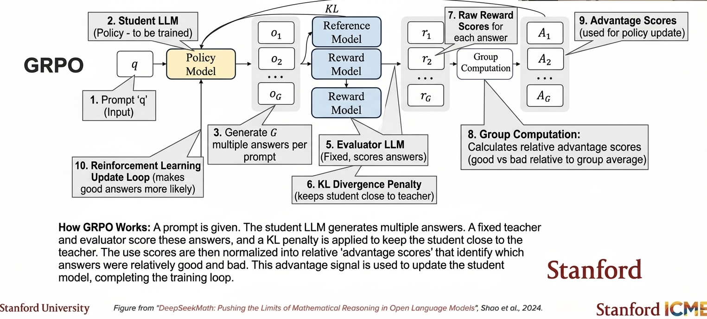


## Chain of Thought (CoT)

- 🎁 Rewards = <think> tokens present + answer correct  

- control thinking: as thinking tokens increase, performance increases

- dynamic budget, context length, budget forcing (introduce tokens midway to force reasoning and force it to _think_ more before generating answer)

>wait, wait, wait, I see ....

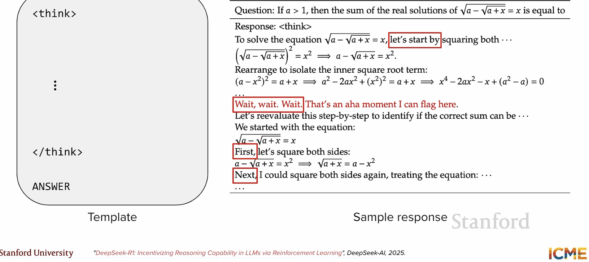


- 🤔 ❓ is this really thought/thinking/reasoning?

- how can we be sure that model is thinking?

- _Concept_ 🧩 🚀

 >models might _think_ in some other space, which may not be human-like reasoning or may not be _language-space_ !

- continuous thoughts: tokens might be hidden representations


## PPO

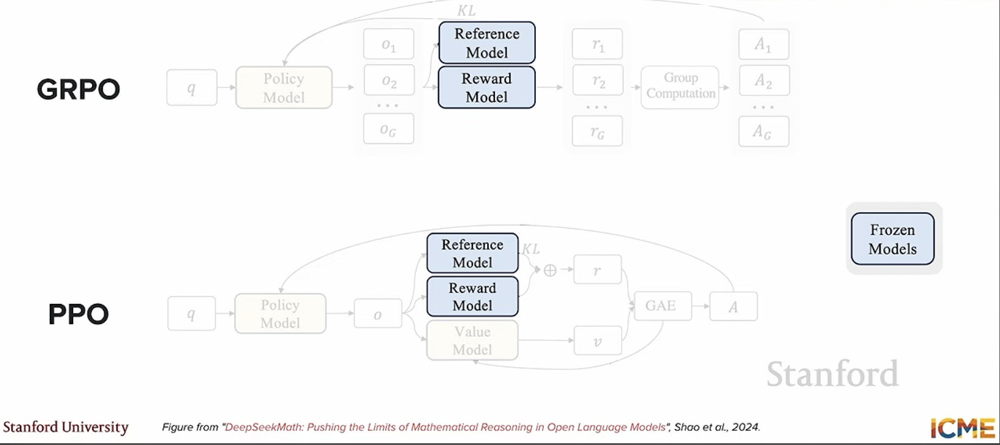

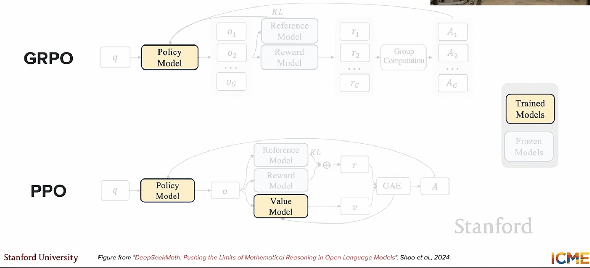


- in the reasoming case, there is no _reward model_ since there is a verifiable output

- in GRPO we only train the _policy model_

- in PPO we train the _policy model_ + _value model_

- GRPO vs PPO math

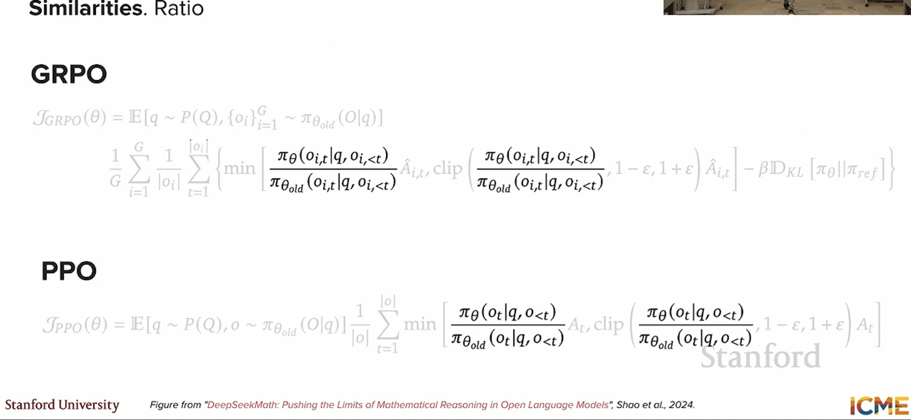

- ratio of probability of current policy to the _old_ policy 

- _clip_ to ensure updates are not too big

- KL divergence term is used to penalize the model if it strays too far from the original model

- _summation_ over all groups and you are sampling multiple completions


- first summation is over group, second summation is over indices of tokens

- _1/length(Output)_ means the contribution of a token depends on the length of the output

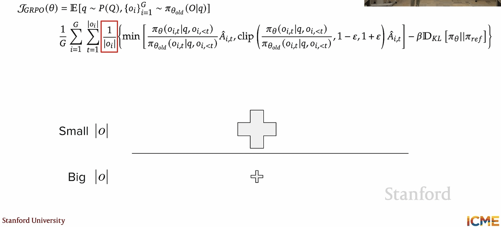

_Note_ that this may be leading to output length becoming bigger and bigger (see Increasing output length section below)

- Fix using Dr. GRPO and DAPO

_Concept_ 🧩 🚀 PPO is used to tune a model and align it to human preferences

_Concept_ 🧩 🚀 GRPO is used to train a model to reason

_Concept_ 🧩 🚀 GRPO does not have a value function


## How do you open the black box and explain reasoning

- [🎥video: How do you open the black box and explain reasoning](https://www.youtube.com/watch?v=Bj9BD2D3DzA)

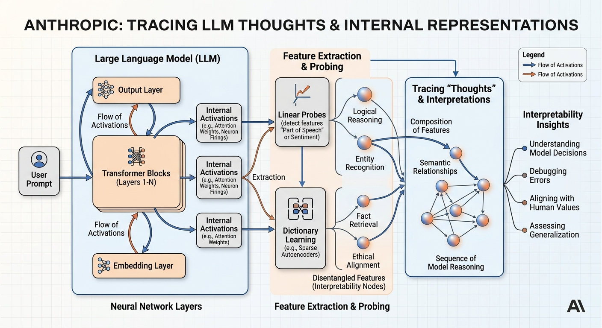


## Increasing output length

- as RL progresses, reasoning tokens increase
- correlated with accuracy

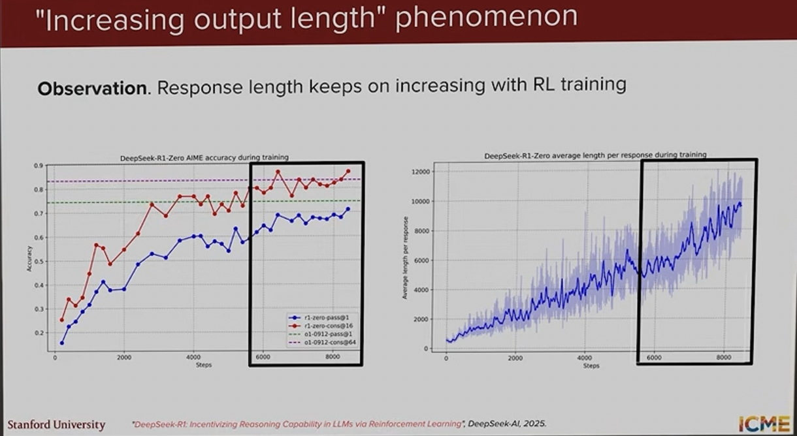


## Other adjustments 

- adjustment for level of difficulty of math problems: most complettions will be failures. so adjust standard deviation

- encourage diversity by tuning _epsilon_ in _clip_ function (so that polcuy changes even if a unlikely token appears)


## Recap

- start with base model
- use SFT (supervised finetuning) and RL (reinforcement learning) to finetune and align models
- use RL (such as _GRPO_) to create another reasoning model

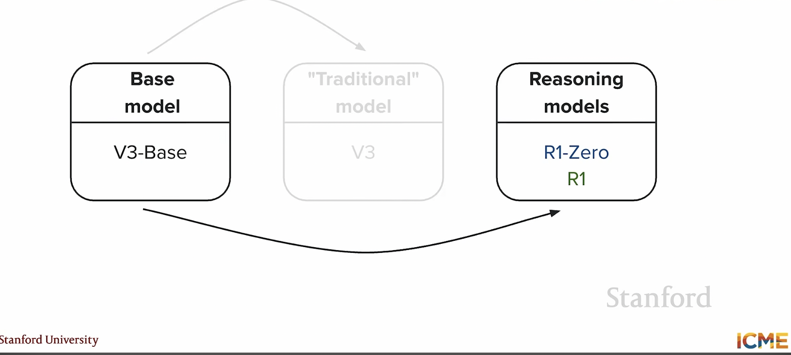


## DeepSeek-R1 model

- start with pretrained model

- multi-head latent attention

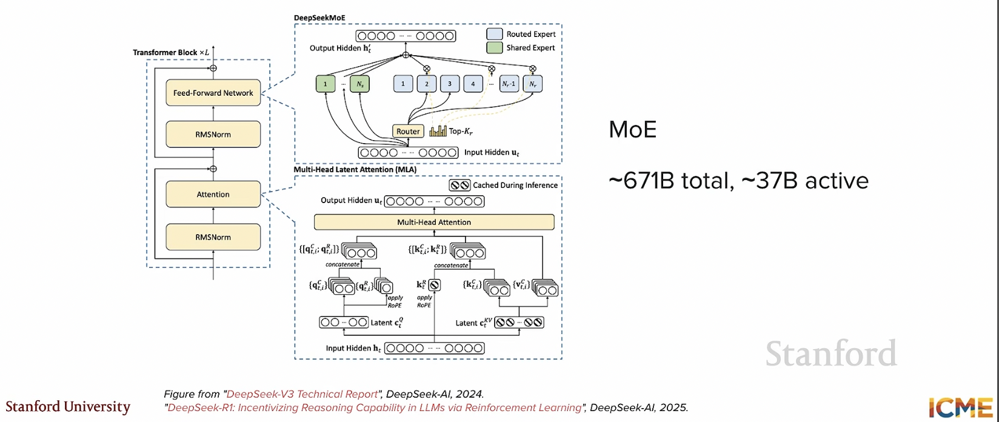

- small scale SFT with reasoning data (data source is chain of thought from R1 model rewritten by humans)

- GRPO with _reward = formatting + accuracy + language consistency_ 

- final SFT on reasoning and non-reasoning data (helpful + harmless)

- deepseek recipe is:

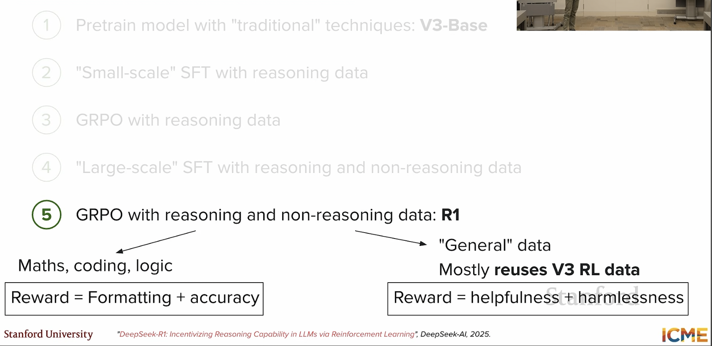

-  🤔 ❓ why does reasoning lead to better results?

- DeepSeek also uses a mixture of experts (MoE) model: see [advanced topics: mixture of experts](advanced_topics.md)


## Talk on reasoning models

- 🎥 [Talk on reasoning models Simons Institute](https://www.youtube.com/watch?v=gAwCSHujtGo)

>reasoning behaviour emerges naturally such as self-verification, backtracking.


- how is the reasoning structured ?
- planning
- implement
- monitor
- verify
- exploration vs exploitation
- provisional answers


- when to stop?
- which path to take ?
- capability _is not equal_ to reasoning capability

- [Schoenfeld 4-stage theory](s)

- analyze, implement, explore, verify


## Distillation

- say you have a smaller model but you want to have the capabilities of a larger model

- _student_ _teacher_ model

- not only match next token distribution

- fit the entire sequence that the _teacher_ has outputted

- not just fit the distribution of tokens

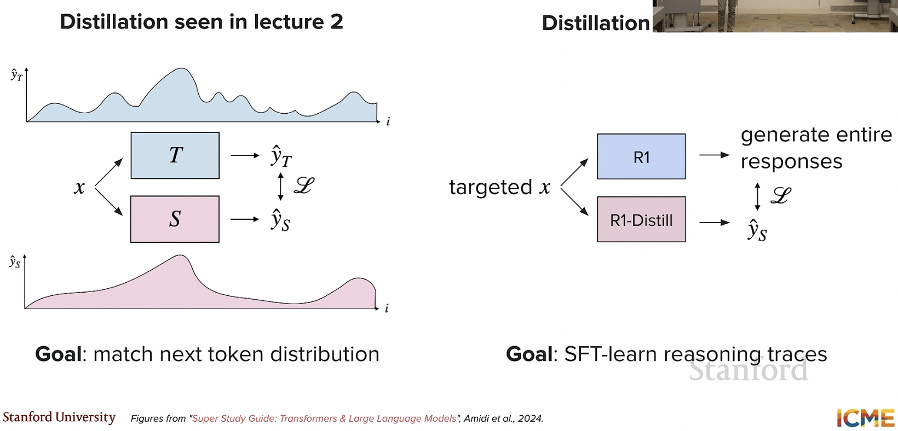


## References

1. [IBM — Reasoning Models](https://www.ibm.com/think/topics/reasoning-model)
2. [Sebastian Raschka — Understanding Reasoning LLMs](https://magazine.sebastianraschka.com/p/understanding-reasoning-llms)
3. [Prompt Engineering Guide — Reasoning LLMs](https://www.promptingguide.ai/guides/reasoning-llms)
4. [Cameron R. Wolfe — Demystifying Reasoning Models](https://cameronrwolfe.substack.com/p/demystifying-reasoning-models)
5. [Maarten Grootendorst — A Visual Guide to Reasoning LLMs](https://newsletter.maartengrootendorst.com/p/a-visual-guide-to-reasoning-llms)
6. [Reddit — How Do Reasoning Models Work?](https://www.reddit.com/r/ArtificialInteligence/comments/1iapbus/how_do_reasoning_models_work/)
7. [YouTube — Reasoning Models](https://www.youtube.com/watch?v=xCRvOUykOX0)
8. [YouTube — Reasoning LLMs](https://www.youtube.com/watch?v=lyEZG3Y614o)
9. [YouTube — GRPO and Reasoning](https://www.youtube.com/watch?v=ygRDcMWHDy0)
10. [YouTube — Reasoning Models](https://www.youtube.com/watch?v=6-mSbIPI4tc&t=211)
