# LLM training

- [🎥 Stanford CME295 video](https://youtu.be/VlA_jt_3Qc4?si=ARV-6XNPgcjXC90c)

## Pretraining

- predict next token

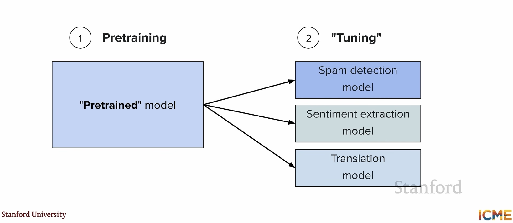

- most expensive step

- _CommonCrawl_, github, stackoverflow

- size: 100B / 1T tokens

## FLOPS

- floating point operations

- 10^25 FLOPS

- _FLOPs = number of tokens * number of parameters_

- see [Resource accounting](materials/resource_accounting.md)

## Scaling

- [Scaling](materials/scaling.md)

- _Chinchilla law_

## LLM training

- decoder only transformer based models

- memory bottleneck

- data parallelism: data distributed on GPUs (each device has a 👮 copy of the model)

- gradient aggregate across GPUs

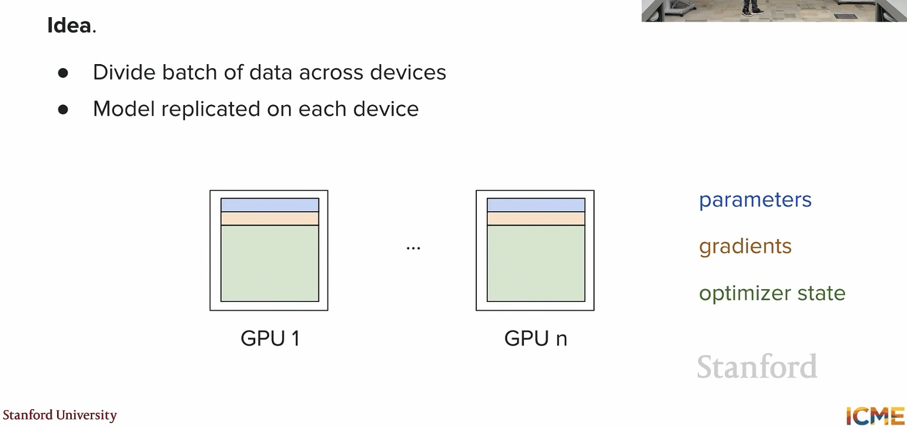

- communication cost between GPUs

## Redundancy

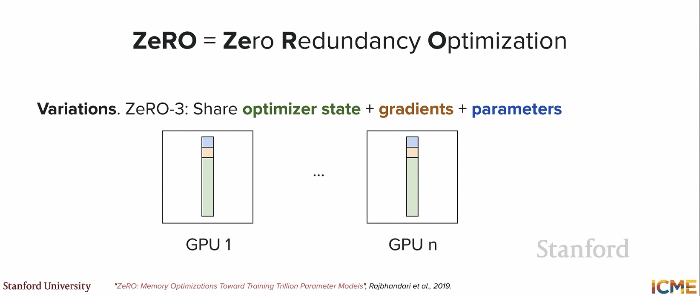

- can share/_shard_ parameters across devices

- more communication costs but decreased memory load per GPU

## Model parallelism

- one expert on one device, another expert on another device

## Flash Attention

- [Flash attention](materials/flash_attention.md)

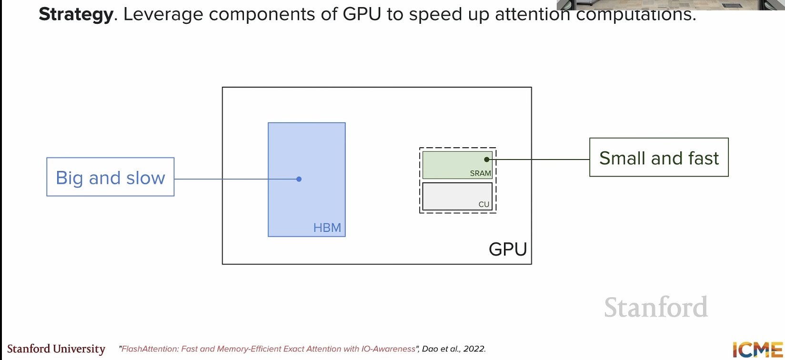

- [🎥video Stanford CME 295 Flash HBM](https://youtu.be/VlA_jt_3Qc4?si=FNBe684MhP3aOlJP&t=2602)

- _tiling_ via SRAM

- small chunks to HBM

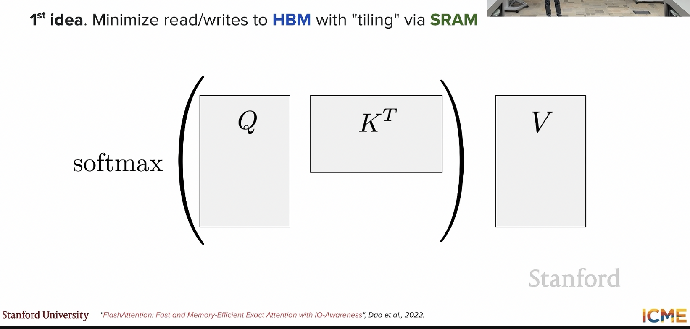

- _Concept_ 🧩 🚀 input/output awareness

- _Concept_ 🧩 🚀 sometimes better to recompute than _store_

## mixed precision training

-  [🎥video Stanford CME 295](https://youtu.be/VlA_jt_3Qc4?si=5BcjSF8jVqTrFTrY&t=3454)

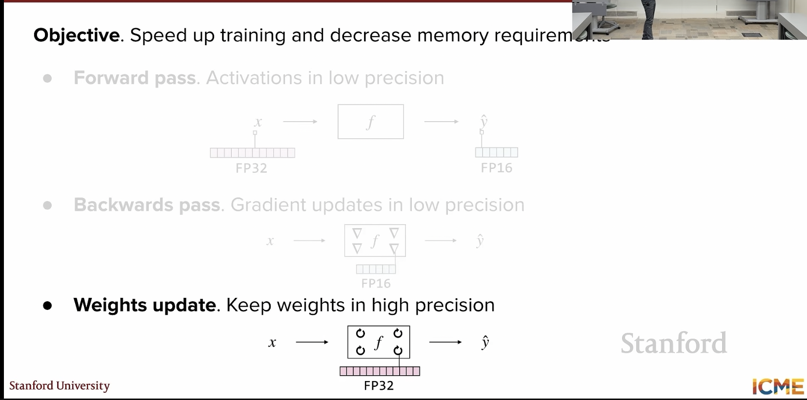

## SFT

- Supervised fine tuning SFT

- instructions tuning

- data from tsaks that users can ask for at inference time (math. chat, code, ...)

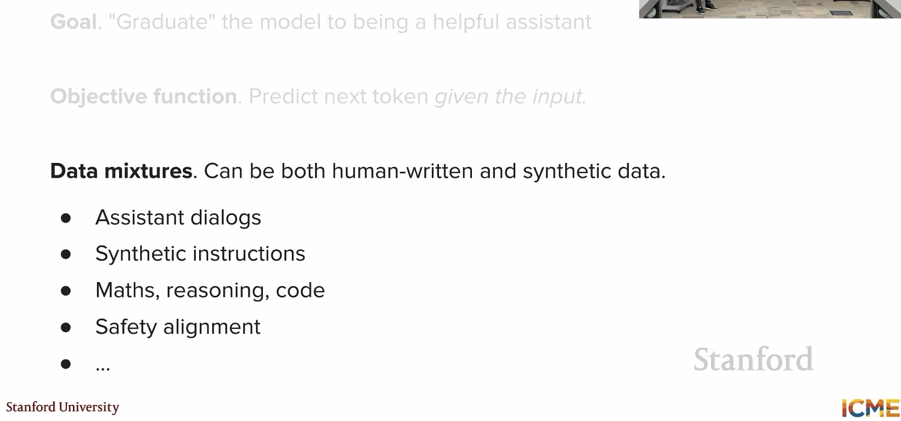

- helpful but harmless

- chatbot arena to give real-life feeling

- do you like emojis in your chatbot response ?

- evaluation is a hard problem and no single metric will do the job

## Lifecycle of LLM

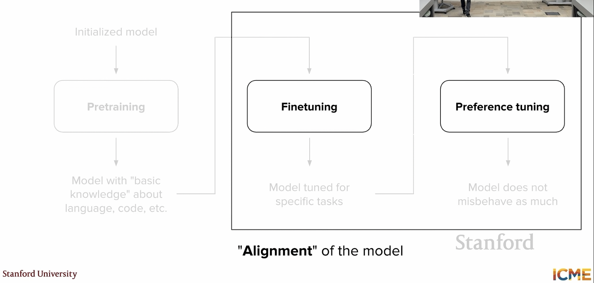

- also midtraining

- not only model alignment

- but also data 

## PEFT 

- Parameter Efficient Fine Tuning

- LoRA Low Rank Adaptation

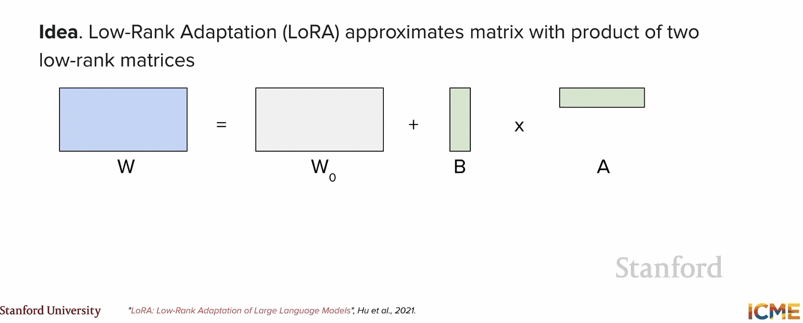

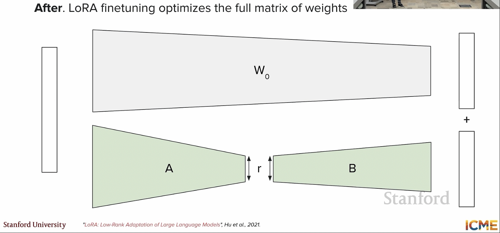

- where to apply LORA?

- mostly in feed-forward network but also in multi-head attention

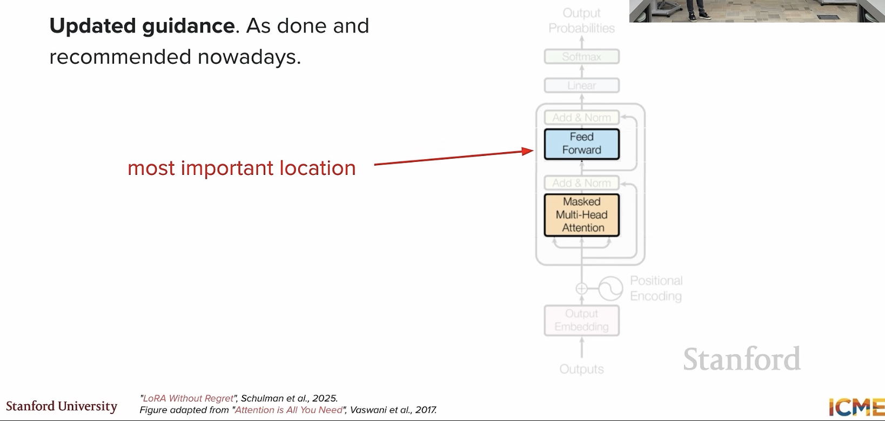

- what rank to use? learning rate? batch size?