# Tuning/finetuning and RLHF

- [🎥 Video CS395 Stanford Finetuning](https://youtu.be/PmW_TMQ3l0I?si=82nhWrdTQSbk0u7b)

- Model already knows what language is (after _pretraining_)

- model then tuned on specific tasks

- preference tuning

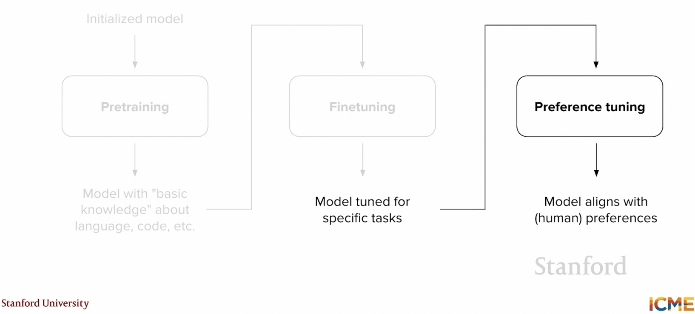

## Preference tuning

- collect preference pairs and train model on it

- We _prefer_ this 

- rather than say I want this

- easier to compare than generate from scratch

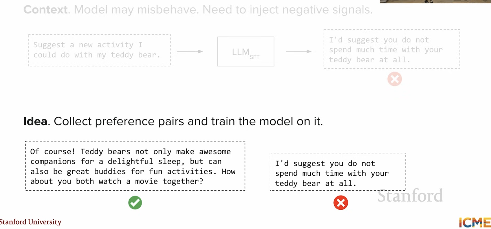

- SFT data quality is very important

- 💡 If SFT data is _misbehaving_ then preference tuning may not be the answer: _check your SFT data_

- also see [RLHF material](week07_finetuning_and_rlhf.md)

- data collection

- pointwise vs. pairwise preference data

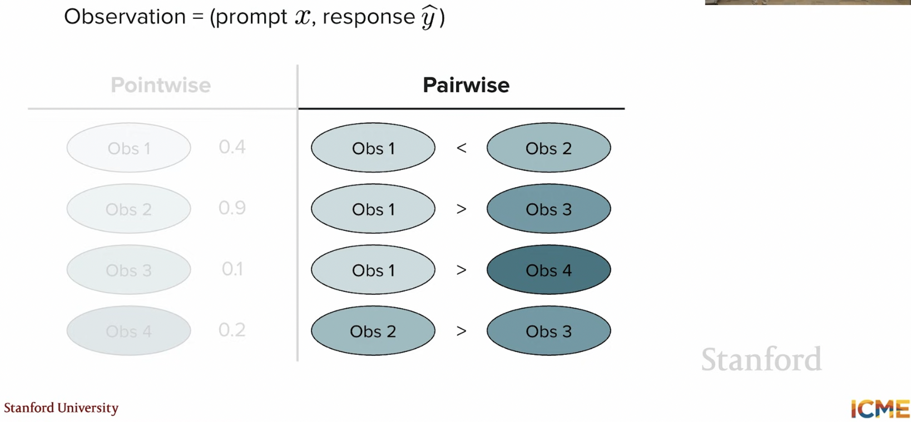

- collect _pairwise_ preference data for prompts

- LLM as a judge

## RLHF

- What is reinforcement learning?

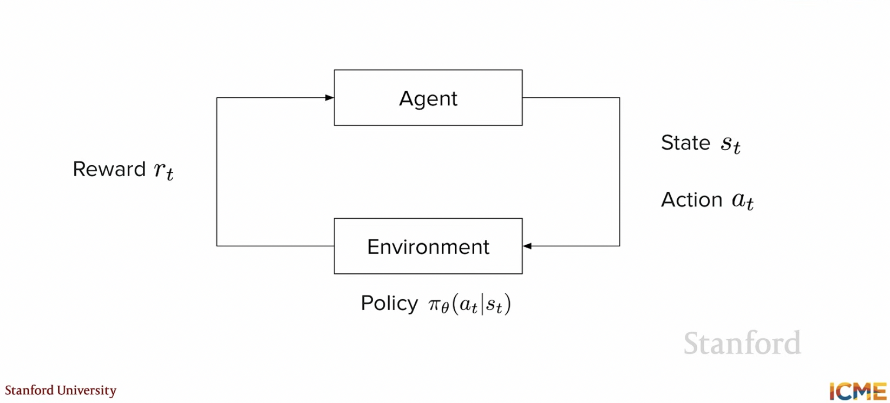

- _s_t_ is state you are in, _a_t_ is action you take, _r_t_ is reward you get

- sometimes a good or bad reward

- leverage this for _preference tuning_

- agent is the LLM

- state is prompt

- next token is next state

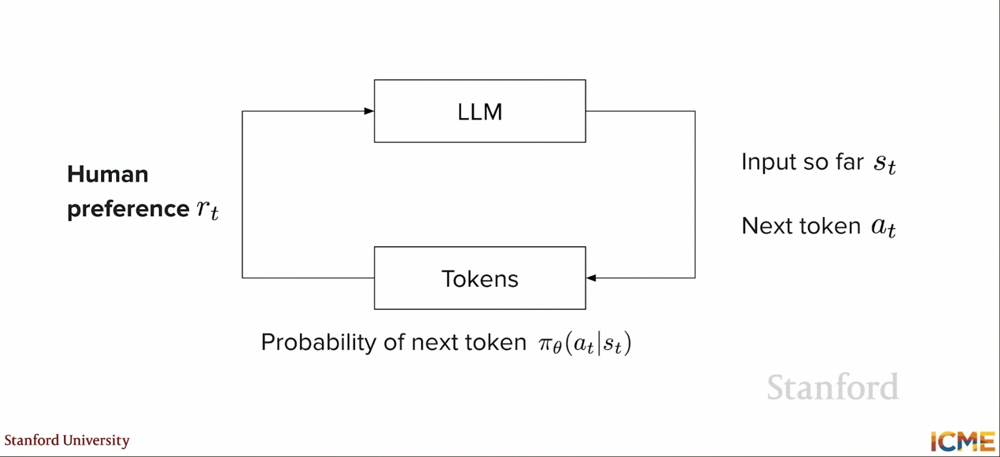

- tune the LLM

- sparse signals could be a problem in RL 

- Bradley-Terry model for preference learning

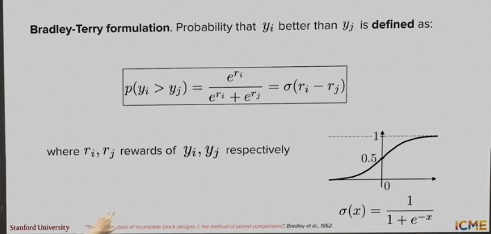

- 💡 binary cross entropy loss function since pairwise

- 💡 take _log_ of multiplication of probabilities: these numbers can get very small

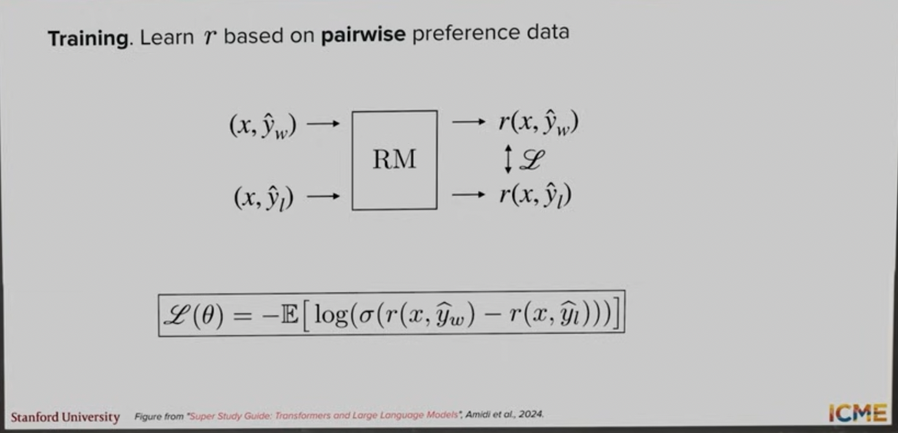

- 1000s of data points from humans

- _Model_ pretrained LLM with classification head instead of next token prediction (decoder only)

- is this regression or reinforcement learning?

- change weights of LLM using reinforcement learning

- reward model has been trained and frozen

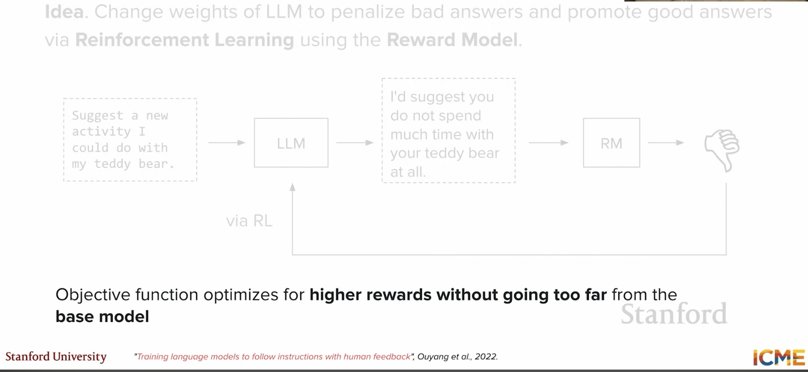

- do not deviate too much from base model: _catastrophic forgetting_

- [see video 🎥 Stanford CME295](https://youtu.be/PmW_TMQ3l0I?si=0JjeBjA0q-9Tem4j&t=3175)

- reward hacking or training instabilities (so not depend too much on reward signal)

## Proximal Policy Optimization (PPO) 

- do not deviate too much from base model

- This is called PPO

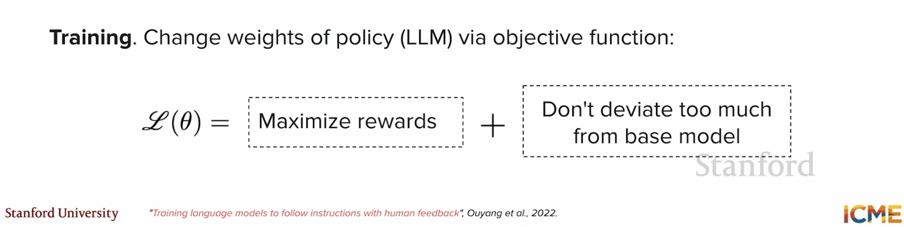

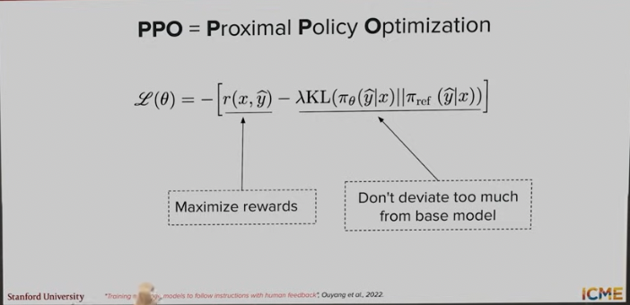

- _KL divergence_ measures how different two probability distributions are 

- it is not distance, it is not symmetric

- 🤔❓ is it positive or negative ?

- use Jensen's inequality to argue it is positive (and 0 if two distributions are identical)

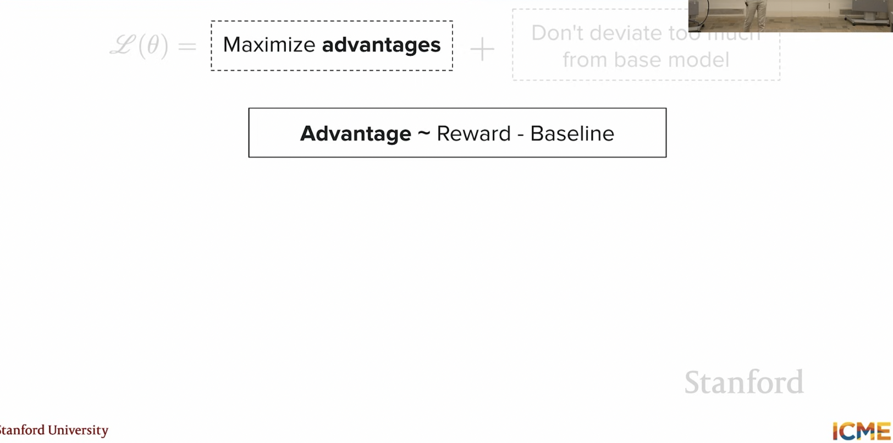

- _advantage_ how much better is output compared to baseline

- _value function_ 

- value head train jointly

- generalized advantage estimation (GAE)

### Variants of PPO loss

- PPO-Clip: clip ratio of new and old policy to prevent large updates

- _old_ is not SFT model but model at previous iteration of RL stage

- 💡 updates not too big (for stability)

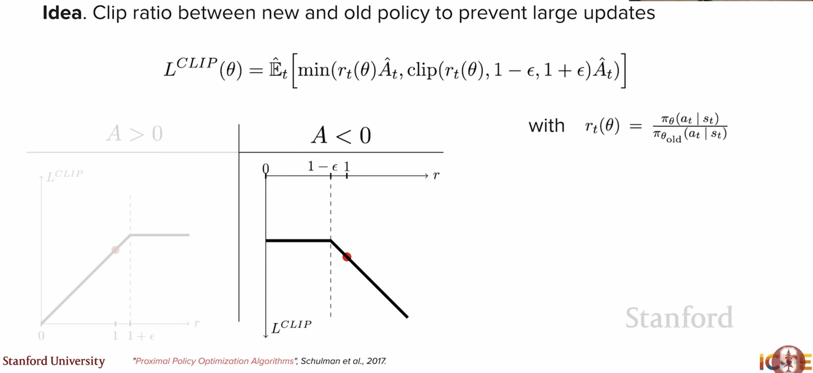

- _L_ is not loss and _r_ is ratio (not reward)

### PPO-KL penalty

- ratio * advantage - KL * (value - old value) 

- can PPO-clip with PPO-KL penalty

- _Limitations_ need a lot of models (policy, value, reward model, base model from SFT)

- can look at [GRPO](reasoning_models_GRPO.md)

- _Limitations_: train reward model 2 stage process

- 💡on-policy (PPO)

- 💡off-policy (SFT)

- SFT on preference data (why not done?)

- SFT cannot be told not generate this

## No RL- Best of N 

- BoN 

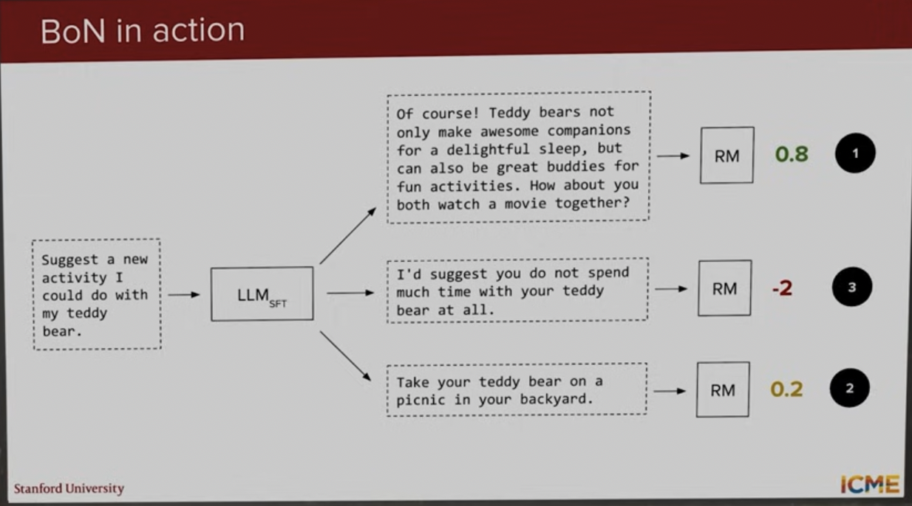

- pushing cost to inference

- if model being served then may not work

- inference traffic dependent

## DPO

- Direct Preference Optimization

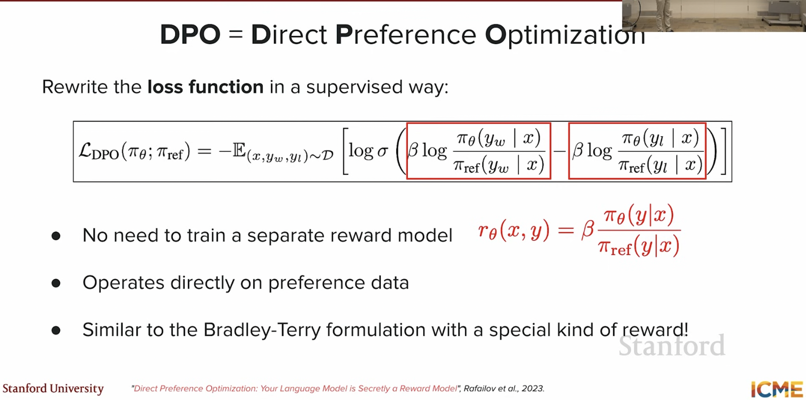